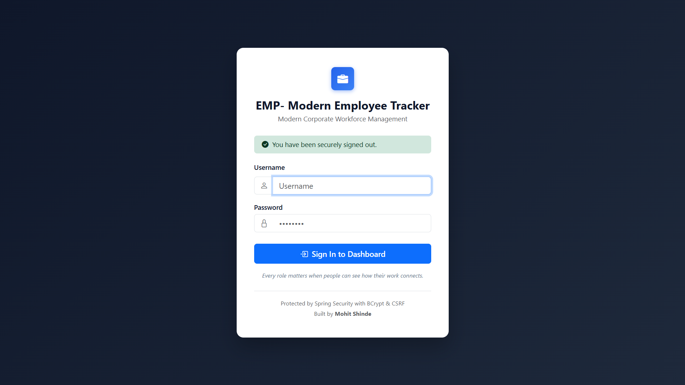
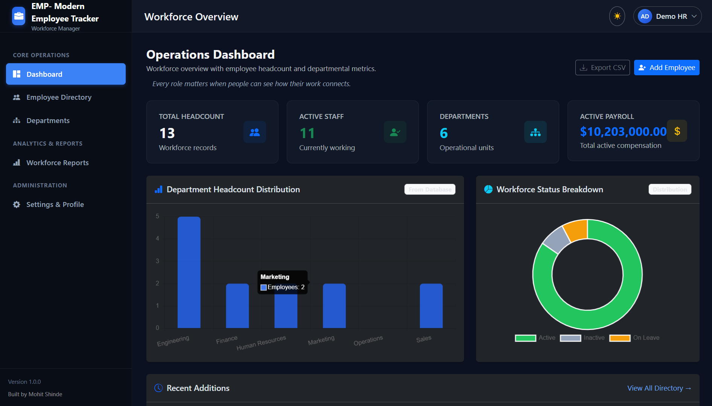
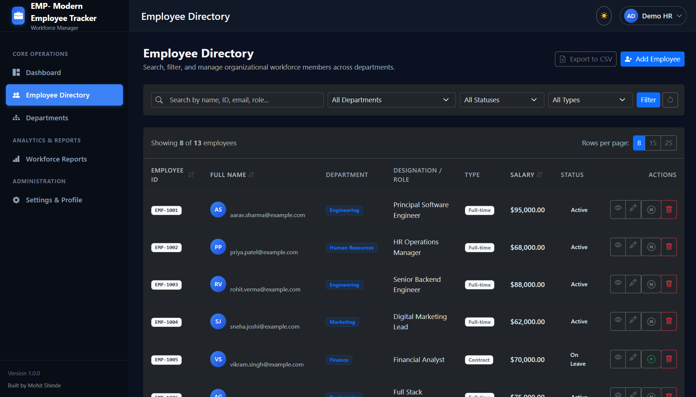
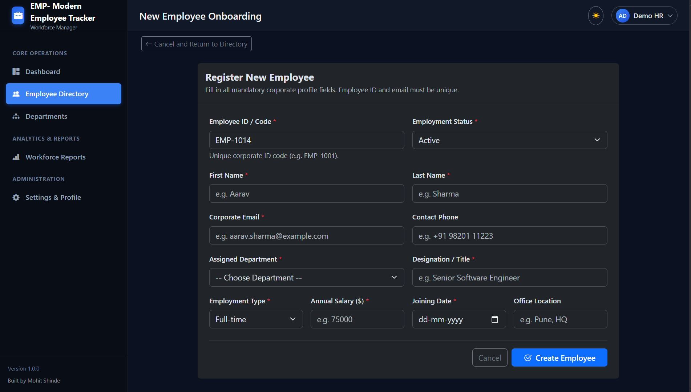
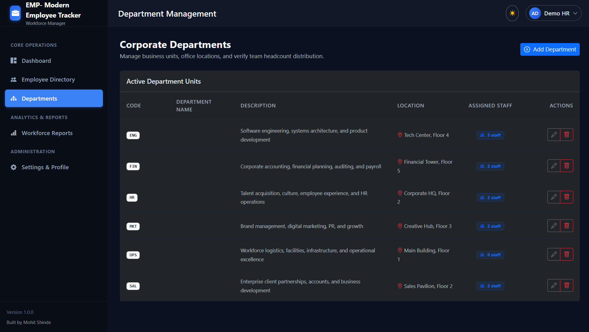
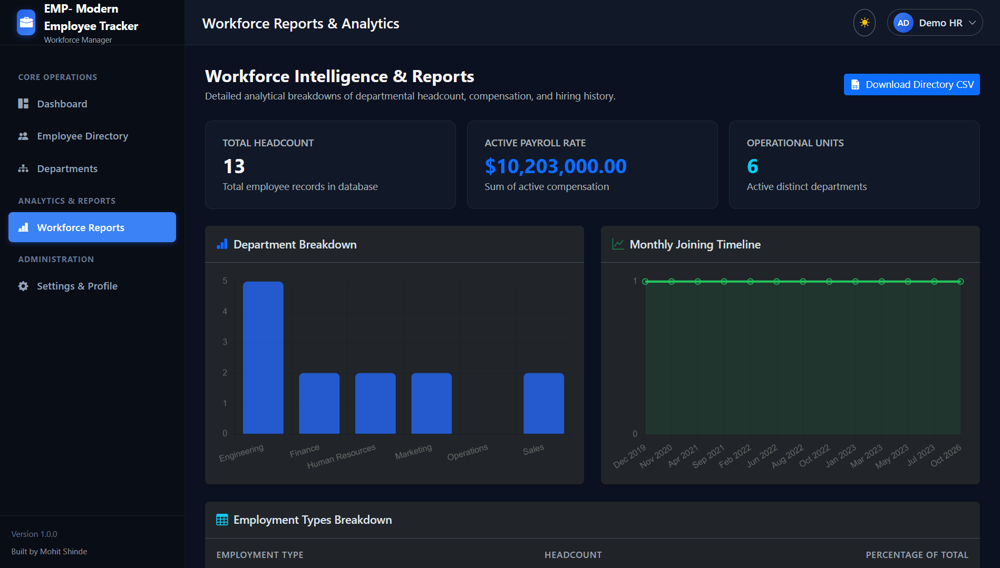

# EMP - Modern Employee Tracker

Built by **Mohit Shinde**

EMP - Modern Employee Tracker is a web application to manage employees and departments of a company. After logging in, an HR person can add employees, search and filter them, see simple charts on a dashboard, and download the employee list as a CSV file.

I built this project to practise Java Development with Spring Boot, and to understand how a login system, a database and a web page work together in one real application.

---

## Screenshots

### Login Page
Users must log in before they can see any page.



### Dashboard
Shows total employees, active staff, departments, active payroll, and two charts (department-wise employees and status-wise employees).



### Employee Directory
Search employees, filter by department / status / type, sort by columns, and change the number of rows per page.



### Add Employee Page
Form to add a new employee. It shows validation errors if the data is wrong.



### Department Management
List of departments with their code, location and number of employees. Departments can be added, edited and deleted.



### Reports & Analytics
Summary cards, a department chart, a monthly joining chart, an employment type table, and a button to download the CSV.



*(The numbers in the screenshots are sample data.)*

---

## Features

- Login and logout using Spring Security
- Passwords are stored in encrypted form (BCrypt)
- Dashboard with employee and department statistics and charts (Chart.js)
- Add, view, edit and delete employees
- Search employees by name, ID, email or designation
- Filter by department, status and employment type
- Sort by employee ID, name and salary
- Pagination with selectable rows per page
- Make an employee Active / Inactive with one click
- Add, edit and delete departments
- A department cannot be deleted if employees are still assigned to it
- Form validation (required fields, valid email, salary greater than zero, unique employee ID and email)
- Reports page with a monthly joining chart and employment type table
- Download all employees as a CSV file
- Settings page to change my name, email and password
- Dark / light theme (the choice is saved in the browser)
- Simple REST APIs under `/api` (they use the same login)
- Sample data is added automatically on first run

---

## Technologies Used

| Technology | Why I used it |
| --- | --- |
| Java 17 | Main programming language |
| Spring Boot 3.3.4 | To create the application quickly with less configuration |
| Spring MVC | Controllers that handle web requests |
| Spring Data JPA (Hibernate) | To save and read data from the database without writing much SQL |
| Spring Security | Login, logout, password encryption and CSRF protection |
| Thymeleaf | To create the HTML pages with data from the backend |
| MySQL | Database |
| Bootstrap 5, HTML, CSS, JavaScript | Page design and small UI features |
| Chart.js | Charts on the dashboard and reports page |
| Lombok | To avoid writing getters, setters and constructors |
| Maven (with Maven Wrapper) | To manage dependencies and run the project |
| H2 | In-memory database used for tests (and an optional profile) |

---

## Project Structure

```
EMP- Modern Employee Tracker/
├── pom.xml                      Maven dependencies
├── mvnw, mvnw.cmd               Maven Wrapper (to run without installing Maven)
├── database/schema.sql          Optional SQL script for the tables
├── docs/screenshots/            Screenshots used in this README
└── src/
    ├── main/
    │   ├── java/com/in/emptrack/
    │   │   ├── controller/      web (HTML pages) and api (REST)
    │   │   ├── service/         business logic
    │   │   ├── repository/      database access (Spring Data JPA)
    │   │   ├── entity/          Employee, Department, AdminUser
    │   │   ├── dto/             request and response classes
    │   │   ├── mapper/          converts entity <-> DTO
    │   │   ├── enums/           EmploymentStatus, EmploymentType
    │   │   ├── security/        Spring Security configuration
    │   │   ├── config/          startup setup (admin user, sample data)
    │   │   └── exception/       custom exceptions and global handler
    │   └── resources/
    │       ├── application.properties
    │       ├── static/          CSS and JavaScript
    │       └── templates/       Thymeleaf HTML pages
    └── test/                    test classes
```

The code follows a simple flow: **Controller -> Service -> Repository -> Database**.

---

## How to Run

### 1. Prerequisites
- Java 17 (JDK)
- MySQL 8 or above (running on port 3306)
- Internet connection (Maven downloads dependencies the first time, and the browser loads Bootstrap and Chart.js from a CDN)

Maven does not need to be installed, the project has `mvnw`.

### 2. Database
The project uses a database named `emp_track_db`. The tables are created automatically by Hibernate when the app starts, so I do not need to create them manually. You can create the database yourself if you want:

```sql
CREATE DATABASE IF NOT EXISTS emp_track_db;
```

(`database/schema.sql` is an optional script. Spring Boot does not run it.)

### 3. Set environment variables
The database settings are read from environment variables. If they are not set, the app uses `root` as both username and password, which will not work on most computers, so please set your own.

| Variable | Meaning |
| --- | --- |
| `DB_USERNAME` | MySQL username (default: `root`) |
| `DB_PASSWORD` | MySQL password |
| `EMPTRACK_ADMIN_USERNAME` | Username for my admin login |
| `EMPTRACK_ADMIN_PASSWORD` | Password for my admin login (minimum 10 characters) |

Windows (PowerShell):
```powershell
$env:DB_USERNAME="root"
$env:DB_PASSWORD="your-mysql-password"
$env:EMPTRACK_ADMIN_USERNAME="your-username"
$env:EMPTRACK_ADMIN_PASSWORD="your-long-password"
```

Mac / Linux:
```bash
export DB_USERNAME="root"
export DB_PASSWORD="your-mysql-password"
export EMPTRACK_ADMIN_USERNAME="your-username"
export EMPTRACK_ADMIN_PASSWORD="your-long-password"
```

If you use Eclipse or IntelliJ, you can add these in the Run Configuration under Environment variables.

### 4. Run the project
Open a terminal in the folder that has `pom.xml` and run:

```bash
./mvnw spring-boot:run
```
On Windows use `mvnw.cmd spring-boot:run`.

### 5. Open and log in
Open http://localhost:8080 in the browser. It will take you to the login page.

- Log in with the admin username and password you set in step 3. The admin account is created only on the first run, when no admin exists in the database.
- The app also creates two demo accounts (`demohr` and `demomanager`) by default for local testing. Their passwords are written in `AdminBootstrap.java` (in the `config` package). They can be turned off by setting `EMPTRACK_DEMO_ACCOUNTS_ENABLED=false`. Do not keep them on a public server.

### Sample data
On the first run, if the database has no departments, the app adds 6 sample departments and 12 sample employees. To start with an empty database, set `EMPTRACK_SEED_DEMO_DATA=false` before the first run.

### Run tests
```bash
./mvnw test
```

---

## Main URLs

| URL | Page |
| --- | --- |
| `/login` | Login page |
| `/` | Dashboard |
| `/employees` | Employee directory |
| `/employees/add` | Add employee |
| `/departments` | Departments |
| `/reports` | Reports and analytics |
| `/settings` | Profile and password |
| `/employees/export/csv` | Download CSV |

## REST APIs

These need a logged-in session. For POST, PUT and DELETE requests the CSRF token is also needed.

| Method | URL | Purpose |
| --- | --- | --- |
| GET | `/api/employees` | List employees (search, filter, sort, paging) |
| GET | `/api/employees/{id}` | Get one employee |
| POST | `/api/employees` | Add employee |
| PUT | `/api/employees/{id}` | Update employee |
| DELETE | `/api/employees/{id}` | Delete employee |
| POST | `/api/employees/{id}/toggle-status` | Change Active / Inactive |
| GET | `/api/departments` | List departments |
| GET | `/api/departments/{id}` | Get one department |
| POST | `/api/departments` | Add department |
| PUT | `/api/departments/{id}` | Update department |
| DELETE | `/api/departments/{id}` | Delete department |
| GET | `/api/dashboard/summary` | Dashboard numbers |

---

## What I Learned

- How a Spring Boot project is divided into controller, service and repository layers
- How Spring Data JPA maps Java classes to database tables, and how to write search and filter queries
- How Spring Security login works, why passwords are hashed with BCrypt, and what CSRF protection does
- Using DTOs and Bean Validation (`@NotBlank`, `@Email`, etc.) instead of using entities directly in forms
- Handling errors in one place with `@ControllerAdvice`
- Showing database data in HTML using Thymeleaf and in charts using Chart.js
- Keeping database passwords in environment variables instead of writing them in the code
- Creating REST APIs and sending proper responses like 404 and 409

---

## Known Limitations

- All logged-in users can use all pages. Roles (Admin, HR, Manager) are saved in the database, but pages are not restricted by role yet.
- Bootstrap, icons and Chart.js load from the internet (CDN), so the page looks incomplete without internet.
- The Department Name column is hard to read in dark theme right now (I plan to fix it).

## Future Improvements (not done yet)

- Role-based access
- Docker setup
- Import employees from a CSV file

---

Built by **Mohit Shinde**
